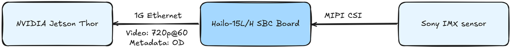

[](https://www.microchip.com)

# Hailo-15 Holoscan Sensor Bridge Reference Design

## Table of Contents
- [Description](#description)
- [Hardware Used](#hardware-used)
- [Software Used](#software-used)
- [Block Diagram](#block-diagram)
- [Quick Start](#quick-start)
- [Building from Source](#building-from-source)
- [Design Description](#design-description)
- [Testing without a Jetson](#testing-without-a-jetson)
- [Release Notes](#release-notes)
- [Known Issues and Limitations](#known-issues-and-limitations)
- [Licensing](#licensing)
- [Related Documentation](#related-documentation)

## Description
This reference design connects a Hailo-15 vision processor to an NVIDIA® Jetson™ AGX Thor™ through NVIDIA Holoscan™ Sensor Bridge (HSB).

The Hailo-15 runs the whole camera pipeline:
- image capture
- ISP, denoise, dewarp and resize
- object detection and tracking on the integrated Hailo AI accelerator

It then sends **raw (unencoded) 720p (1280x720) NV12 video at 60 fps** over **1 Gigabit Ethernet**, using the HSB protocol. Detection results travel alongside the video as a metadata stream: bounding box, class, confidence and track ID for each object.

On the Jetson side, a Holoscan application receives the video and displays it with the detections overlaid. This application is the starting point for robot perception software.

The design is tied to the exact hardware and software versions listed below.

## Hardware Used
| Item | Validated |
|---|---|
| Vision processor board | Hailo-15L SBC (`hailo15l-sbc`), Hailo-15H SBC rev3.1 (`hailo15-sbc-rev3-1`) |
| Image sensor + lens | IMX678 + Theia SL410M, IMX675 + Theia SL410M, IMX662 |
| Host | NVIDIA Jetson AGX Thor Developer Kit |
| Network | 1GbE link (Ethernet cable) |

## Software Used
| Component | Version |
|---|---|
| Hailo-15 Yocto BSP | [meta-hailo-soc](https://github.com/hailo-ai/meta-hailo-soc) `v1.13.0` (kirkstone) |
| Hailo Media Library | [hailo-media-library](https://github.com/hailo-ai/hailo-media-library) `1.13.0` (`fc452a16`) |
| NVIDIA JetPack | 7.2 |
| NVIDIA Holoscan Sensor Bridge | 2.7 |
| NVIDIA Holoscan SDK | 4.4.0 |

## Block Diagram



## Quick Start
Pre-built images are not released yet. Once they are, the steps are:

1. Download the pre-built image for your board from the release page (link added at release).
2. Flash the image to the Hailo-15 SBC:
    - Hailo-15L: TBD
    - Hailo-15H: TBD
3. Connect the Hailo-15 SBC to the NVIDIA Jetson AGX Thor over the 1GbE link listed in
   [Hardware Used](#hardware-used).
4. Power on the Hailo-15 SBC. The sender starts automatically and waits for the Jetson.
5. Start the receiver application on the Jetson: TBD.

## Building from Source
TBD

## Design Description
TBD

## Testing without a Jetson
The data path can be verified with only a Linux PC (or WSL) on the same 1GbE link: synthetic test
patterns are checked byte-for-byte live over RoCEv2 and offline from captures of both RoCEv2 and
COE (IEEE 1722B), the transport the Jetson AGX Thor uses. See
[docs/data-verification.md](docs/data-verification.md).

```bash
scripts/run_data_tests.sh -b 10.0.0.1
```

## Release Notes
See [CHANGELOG.md](CHANGELOG.md).

## Known Issues and Limitations
None recorded yet.

## Licensing
This project is licensed under the MIT License. See [LICENSE.md](LICENSE.md). Third-party components are listed in [THIRD_PARTY_NOTICES.md](THIRD_PARTY_NOTICES.md).

## Related Documentation
- [Hailo-15](https://hailo.ai/developer-zone/documentation/)
- [NVIDIA Holoscan Sensor Bridge](https://github.com/nvidia-holoscan/holoscan-sensor-bridge)
- [HSB Emulator](https://docs.nvidia.com/holoscan/sensor-bridge/2-7-latest/emulation/hsb-emulator)

NVIDIA, Jetson, Thor and Holoscan are trademarks of NVIDIA Corporation.
